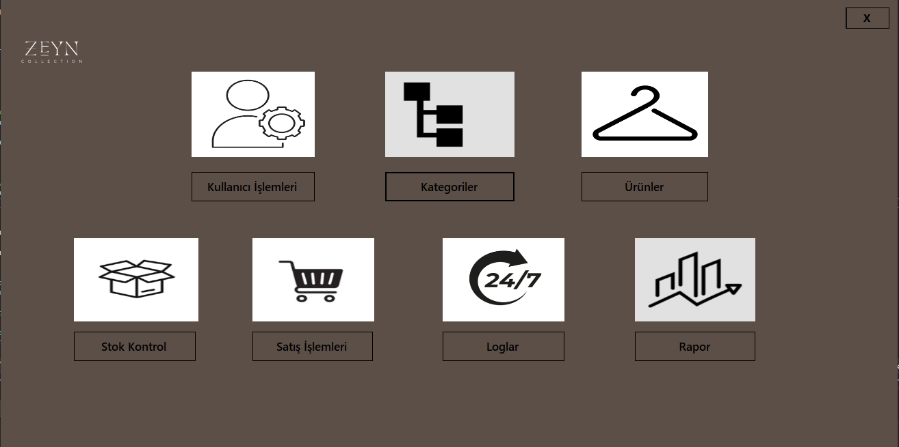
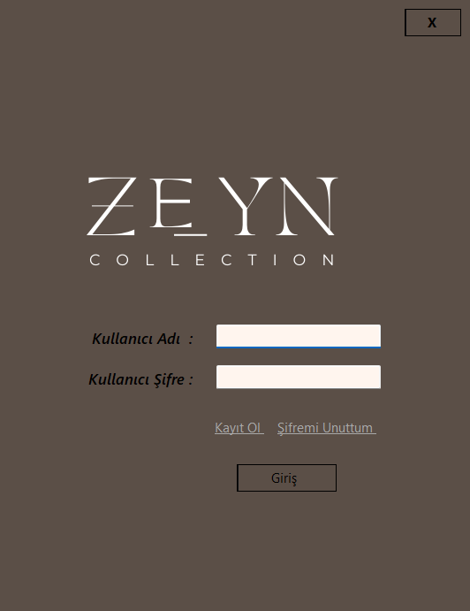
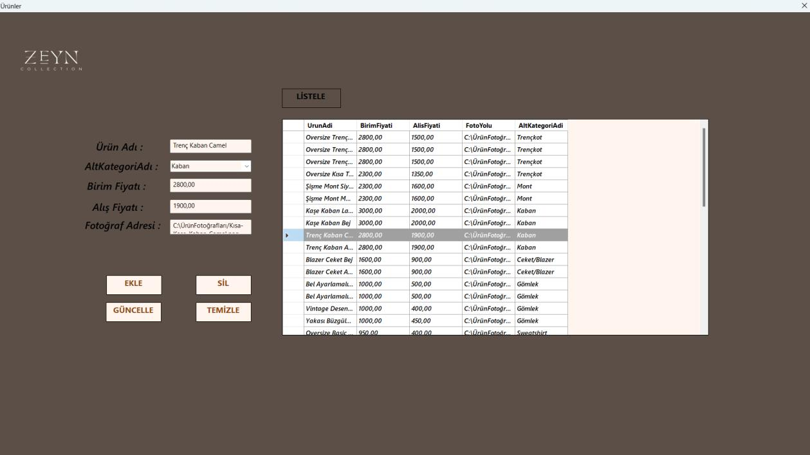
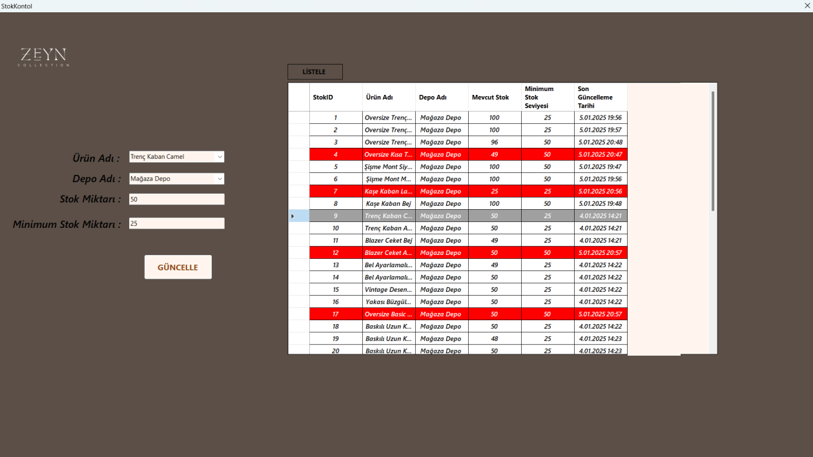
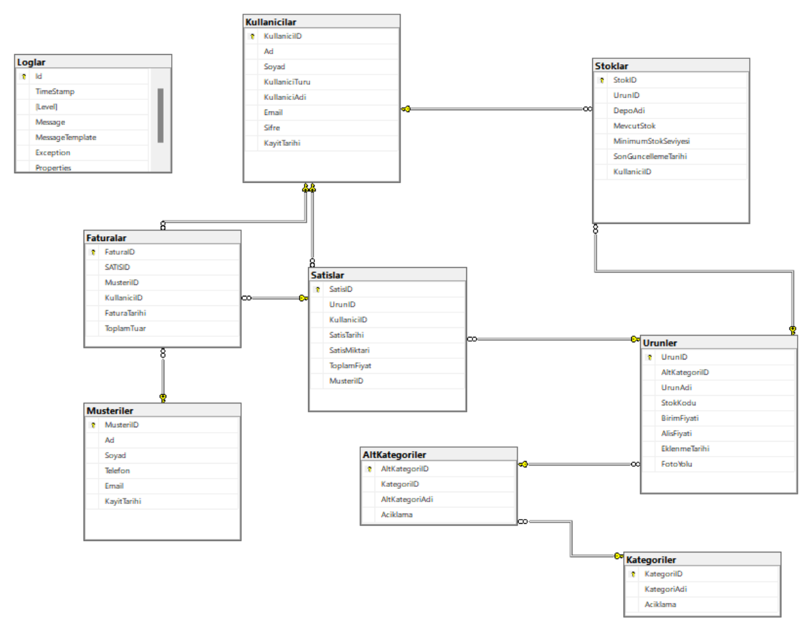

# Stock Tracking System 📦


A desktop **stock tracking and sales management application** built with C# Windows Forms and Microsoft SQL Server. It was designed for a clothing brand and lets staff and managers manage products, track stock levels, record sales and issue invoices.

<p align="center">
  
</p>

> The application interface is in Turkish.

## Features

- **Role-based login:** staff and managers sign in with their own accounts; new users can register and reset their password
- **User management:** add, update, delete and search users (staff / manager)
- **Categories:** browse products by category and subcategory with product photos
- **Product management:** add, update and delete products with prices and photo path
- **Stock control:** track current and minimum stock per product; **low-stock rows are highlighted in red** and the last user who changed the stock is recorded
- **Sales:** register customers, add products to a cart, complete the sale and stock is updated automatically
- **Invoices:** managers can view issued invoices
- **Reports:** list sales, filter them by date and see the top-selling staff member
- **Logging:** application events (logins, errors, product changes) are written to a database table with Serilog

## Screenshots

| Login | Products |
|---|---|
|  |  |

**Stock control** (rows below the minimum stock level turn red):

<p align="center">
  
</p>

## Database Design

The database (`stoktakipsistemi`) has tables for users, customers, categories, subcategories, products, stocks, sales, invoices and logs.

<p align="center">
  
</p>

## Tech Stack

| Area | Technologies |
|---|---|
| Language | C# |
| UI | Windows Forms (.NET) |
| Database | Microsoft SQL Server (SQL Express), ADO.NET (`System.Data.SqlClient`) |
| Logging | Serilog |
| Tools | Visual Studio |

## Getting Started

### Requirements

- Windows 10/11
- Visual Studio 2022 with the **.NET desktop development** workload
- SQL Server Express (and SQL Server Management Studio)

### 1. Clone the repository

```bash
git clone https://github.com/Zeyntrn/StockTrackingSystem.git
```

### 2. Create the database

In SQL Server Management Studio, create an empty database named `stoktakipsistemi` and create the tables shown in the [Database Design](#database-design) section. The application starts without any data: register your first user from the registration screen.

### 3. Set the connection string

Open `SqlBaglanti.cs` and replace the server name with your own SQL Server instance:

```csharp
Data Source=YOUR_SERVER_NAME\SQLEXPRESS;Initial Catalog=stoktakipsistemi;Integrated Security=True;TrustServerCertificate=True
```

The connection uses Windows authentication, so no password is stored in the code.

### 4. Product photos

Product photo paths are stored in the database (`FotoYolu` column) as full file paths. Put your own images in a folder on your computer and enter their paths when adding products.

### 5. Build and run

Open the `.sln` file in Visual Studio and press **F5**.

## What I Learned

- Designing a relational database with foreign keys and connecting it to a Windows Forms application
- Using parameterized SQL queries to avoid SQL injection
- Implementing role-based access and logging with Serilog
- Structuring data-access code into separate classes

## About

Developed by **Zeynep Turan** as the final project of the *Visual Programming I* course, Computer Programming program, Bursa Uludağ University (2025).

## License

This project is licensed under the [MIT License](LICENSE).
